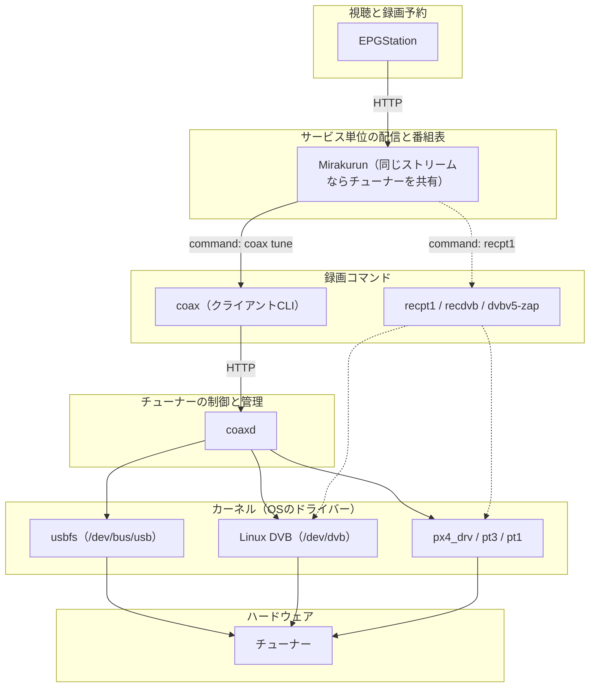
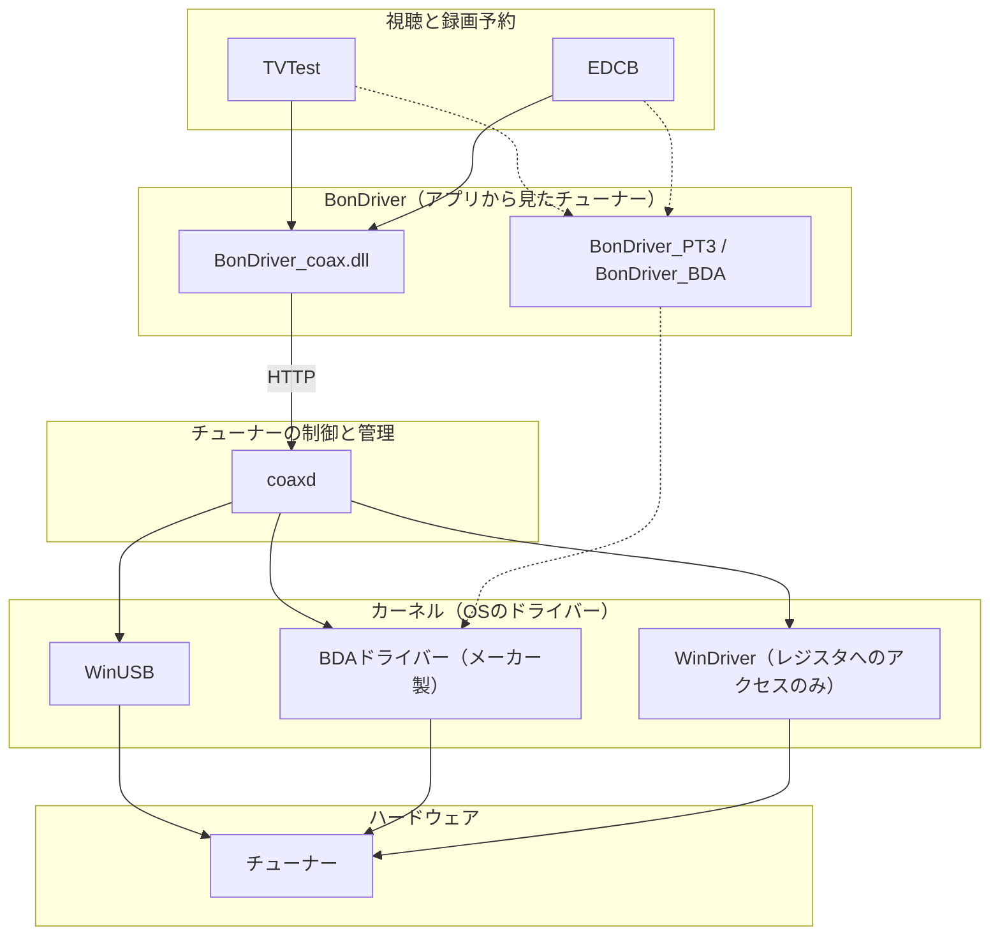

# 既存のチューナー管理ソフトウェアとの違い

coaxが、Mirakurun、EPGStation、TVTest、EDCB、recpt1とどこで接続するかをまとめます。
`coax`と`coaxd`自身の使い方は[本体README](../README.md)にあります。

Mirakurunもcoaxも、HTTPでストリームを取り出せる点は同じですが、役割が異なります。
Mirakurunが配信するのはサービス単位のストリームで、同じストリームを受信している間は、複数の要求で1つのチューナーを共有します。
番組表の定期的な取得もMirakurunが行います。
`coaxd`が提供するのはチューナー単位のストリームで、1つの接続が1つのチューナーを占有します。
番組表もチャンネル一覧も持たず、選局先は毎回クライアントが指定します。
`coaxd`はMirakurunを置き換えるものではなく、その下で動作するものです。

## Linuxディストリビューション

Mirakurunから見ると、`coax tune`は`recpt1`や`recdvb`、`dvbv5-zap`と同じ録画コマンドです。
違いは、チューナーを開くのが`coax`ではなく`coaxd`で、1つの`coaxd`がすべてのバックエンドをまとめ、チューナーの割り当ても決めることです。
点線は、`coaxd`を通さない従来の経路です。

## Windows

TVTestとEDCBは、`BonDriver_coax`をほかのBonDriverと同じように読み込みます。
Mirakurunが無くても、`coax list`に表示されるチューナーをそのままTVTestやEDCBで使えます。
